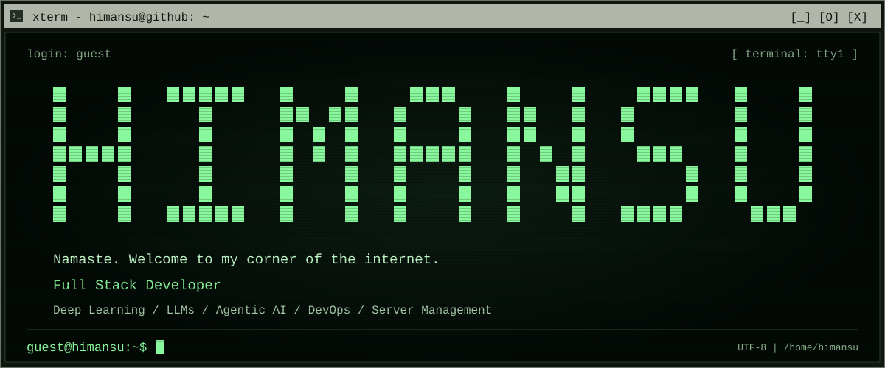

<p align="center">
  
</p>

<p align="center">
  <a href="#whoami"><code>[1] whoami</code></a> &nbsp;
  <a href="#stack"><code>[2] stack</code></a> &nbsp;
  <a href="https://github.com/himansu9805?tab=repositories"><code>[3] repositories</code></a> &nbsp;
  <a href="https://github.com/himansu9805?tab=stars"><code>[4] bookmarks</code></a>
</p>

<a name="whoami"></a>

### `guest@himansu:~$ whoami`

```text
NAME     Himansu
ROLE     Full Stack Developer

Namaste. I build web and Android applications, work with AI,
and manage the infrastructure that keeps software running.

INTERESTS
  [01] Full-stack development
  [02] Deep learning & large language models
  [03] Agentic AI
  [04] DevOps & server management
```

<a name="stack"></a>

### `guest@himansu:~$ tree toolbox/`

```text
toolbox/
|
+-- languages/
|   +-- C++ / Python / Go
|   `-- JavaScript / TypeScript
|
+-- frontend/
|   `-- React / Angular
|
+-- backend/
|   `-- Express / FastAPI / Flask / Spring Boot / .NET
|
+-- databases-and-caching/
|   `-- PostgreSQL / MongoDB / Redis
|
+-- messaging-and-streaming/
|   `-- RabbitMQ / Apache Kafka
|
`-- infrastructure/
    `-- Docker / Kubernetes
```

### `guest@himansu:~$ cat background.txt`

```text
2025  M.Tech
      National Institute of Technology Jalandhar

2023  B.E. in Computer Engineering

NEXT  Explore Linux internals & kernel development.
```

### `guest@himansu:~$ ls -l links/`

[`repositories/`](https://github.com/himansu9805?tab=repositories) &nbsp; [`bookmarks/`](https://github.com/himansu9805?tab=stars)

```text
guest@himansu:~$ _
```
